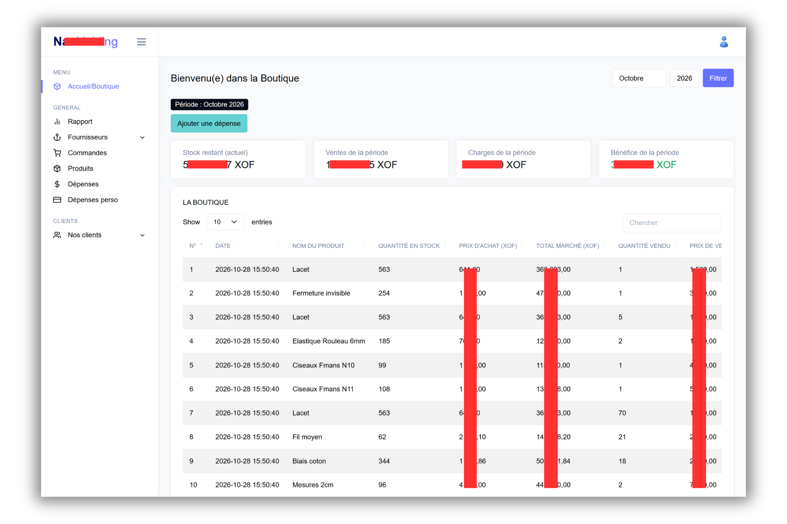
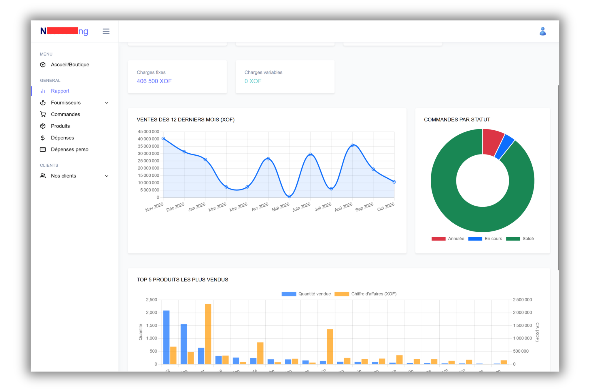
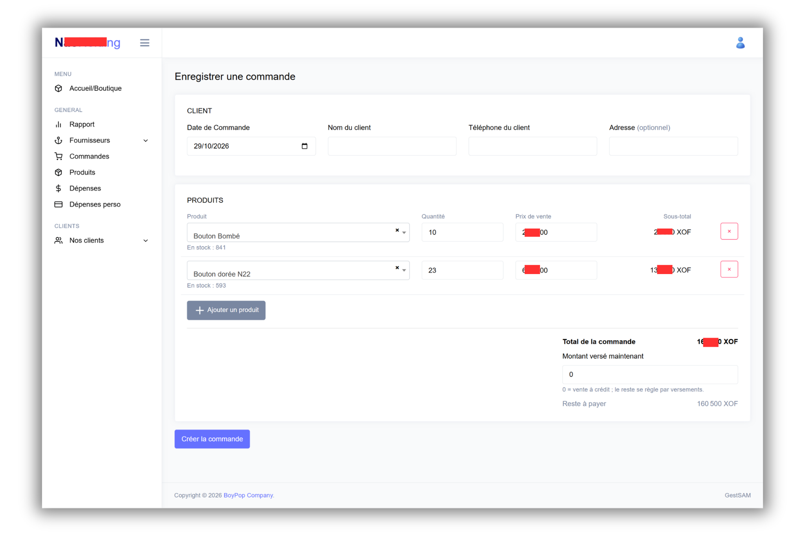
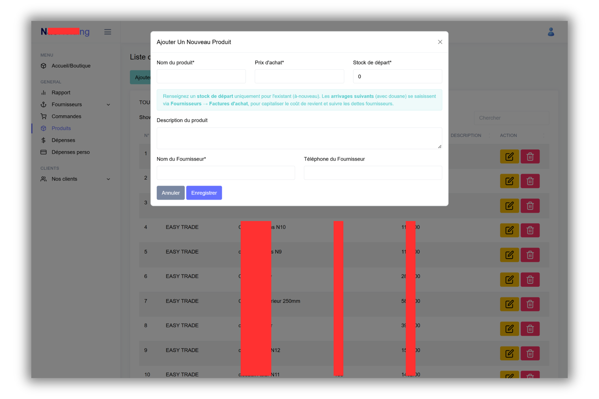
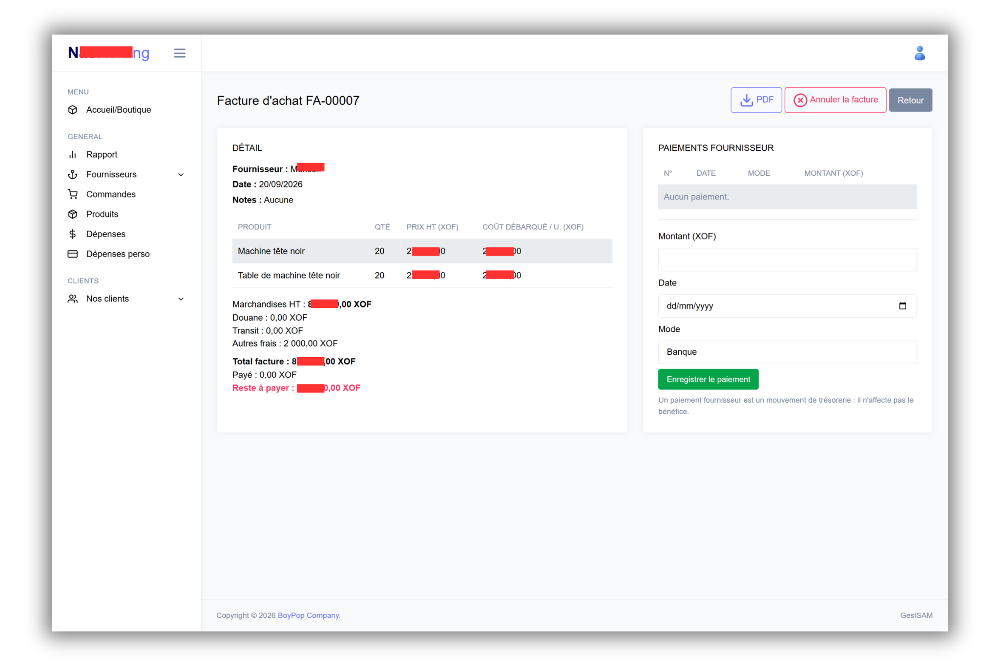
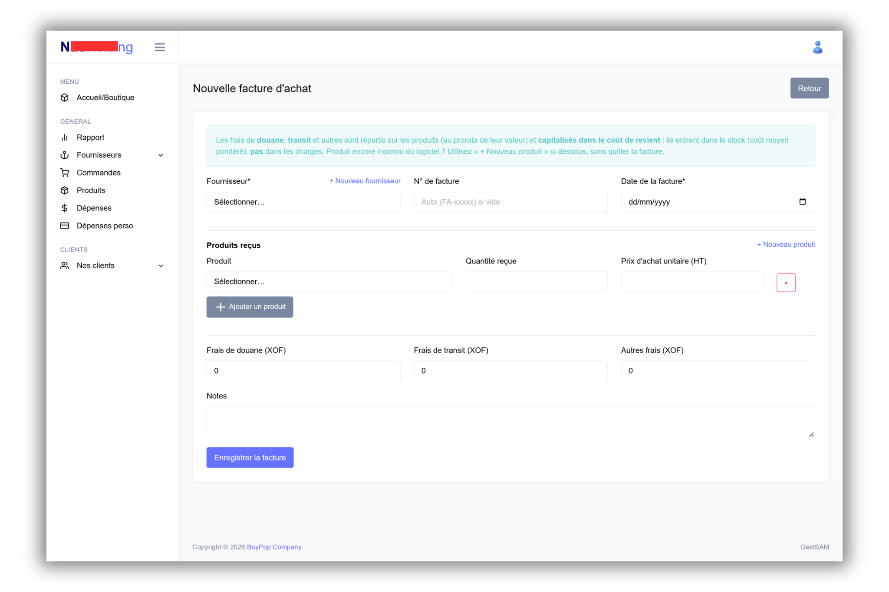
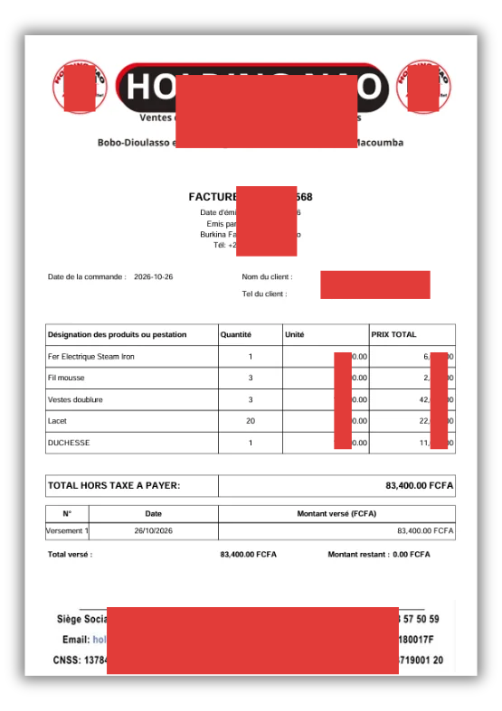

# 🏪 GestSam : Système de Gestion Commerciale

> Application web complète de gestion d'un commerce de négoce, développée avec **Laravel 11**. En production et utilisée quotidiennement par les équipes de l'entreprise.

   

🇬🇧 [English version](README.md)

---

## 📌 Présentation

**GestSam** est une application de gestion interne qui couvre tout le cycle d'un commerce de négoce : achats auprès des fournisseurs, valorisation du stock, commandes clients avec paiements partiels, facturation PDF, charges d'exploitation et rapport de bénéfice par période.

Le projet a été réalisé pour **NAO Holding** (Bobo-Dioulasso, Burkina Faso). Il est **en production**, avec deux rôles d'utilisateur : **admin** (accès complet) et **comptable** (ventes uniquement, coûts et bénéfice masqués).

La version 2026 a refondu le cœur comptable : stock valorisé au coût moyen pondéré, coût des ventes figé au moment de la vente, et séparation nette entre achats de marchandises et charges d'exploitation. Le bénéfice se calcule désormais ainsi : **ventes − coût des ventes − charges d'exploitation**, par mois ou par année.

---

## ✨ Fonctionnalités principales

### 🛒 Ventes & commandes
- Création de commandes multi-produits avec sélecteur de produit avec recherche (Select2)
- Vérification de la disponibilité du stock avant validation
- Calcul automatique du total, du montant payé et du reste à payer
- **Versements** : paiements partiels numérotés par commande, montant payé réconcilié avec les versements
- Statuts : **En cours**, **Soldé**, **Annulée**
- L'annulation restaure le stock et recalcule la dette du client ; les commandes annulées sont exclues de tous les rapports
- Modification complète d'une commande avec synchronisation du stock et de la dette (édition d'une commande annulée refusée)

### 🧾 Factures clients (PDF)
- Générées avec **FPDF**, en-tête et pied de page de la société, nom et téléphone du client
- Numéro de facture formaté (`FAC-00001`)
- Détail des lignes, total, montant versé et reste à payer

### 👥 Clients
- Création automatique du client à la première commande
- Dette calculée dynamiquement à partir des commandes non soldées
- Mise à jour manuelle du nom, du téléphone et de l'adresse

### 📦 Produits & stock
- Catalogue produits avec création de fournisseur à la volée
- **Coût moyen pondéré (CUMP)** : le coût unitaire est recalculé à chaque entrée de stock
- **Coût figé à la vente** : chaque ligne de commande enregistre le coût d'achat du moment, les marges historiques ne bougent donc plus
- Prix d'achat en lecture seule sur la fiche produit (piloté par les factures d'achat) ; la quantité reste modifiable comme ajustement d'inventaire
- Protection contre les stocks négatifs au niveau du modèle (`booted()`)
- Création rapide d'un produit depuis le formulaire de facture d'achat

### 🏭 Fournisseurs & achats (admin uniquement)
- Liste des fournisseurs avec formulaire d'édition et création à la volée
- **Factures d'achat** : marchandises reçues plus frais de douane, de transit et autres frais, **répartis sur les produits et capitalisés** dans leur coût (aucune charge immédiate)
- **Paiements fournisseurs** (banque ou caisse) : numérotés, suivis comme trésorerie, sans impact sur le bénéfice ; statut de facture impayée / partielle / payée
- Vue **Dettes fournisseurs** : factures ouvertes et total dû
- Annulation d'une facture d'achat qui rétablit le stock et le coût, refusée si un paiement existe ou si la marchandise a déjà été vendue
- **PDF** de facture d'achat (DomPDF)

### 💸 Dépenses
- Catégories : charge d'exploitation, achat de marchandises, douane/transit, paiement fournisseur. **Seules les charges d'exploitation réduisent le bénéfice**
- Charges ventilées en **fixes** (loyer, salaires) et **variables** (électricité, transport)
- Ajout, modification et suppression des dépenses

### 📊 Tableau de bord & rapport
- Affichage par défaut du **mois courant**, avec sélecteur mois / année (ou toute l'année)
- Chiffres de la période : ventes, coût des ventes, charges fixes et variables, **bénéfice net**, achats de la période
- Soldes actuels : valeur du stock, dettes clients, dettes fournisseurs
- Rapport admin avec **Chart.js** : top 20 produits, top clients, évolution des ventes sur 12 mois
- Cartes d'indicateurs sur le tableau de bord

### 👛 Dépenses personnelles
- Salaire mensuel et journal des dépenses personnelles par catégorie (nourriture, transport, famille, santé, loisirs, autre)
- Solde restant, pourcentage consommé, projection de fin de mois et budget journalier pour le mois en cours
- Comparaison avec le mois précédent et historique sur 6 mois

### 🔐 Rôles & sécurité
- Deux rôles portés par l'utilisateur : **admin** et **comptable**
- Middleware `EnsureAdmin` sur le rapport, les produits, les fournisseurs et les achats ; le menu et les colonnes de coût s'adaptent au rôle
- Connexion limitée à 5 tentatives par minute, bouton afficher/masquer le mot de passe
- Comptes initiaux pilotés par le `.env`, aucun mot de passe en clair dans le dépôt
- Opérations critiques (commandes, annulations, factures d'achat, paiements) encadrées par des **transactions DB**

---

## 📸 Captures d'écran

### Accueil
<p align="center">
  
</p>

### Tableau de bord
<p align="center">
  
</p>

### Créer une commande
<p align="center">
  
</p>

### Créer un produit
<p align="center">
  
</p>

### Facture d'achat
<p align="center">
  
</p>

### Créer une facture d'achat
<p align="center">
  
</p>

### Facture client
<p align="center">
  
</p>

---

## 🗄️ Modèle de données

```
Fournisseur ──< FactureAchat ──< FactureAchatLigne >── Produit
                   │                                      │
                   └──< PaiementFournisseur               │
                                                          │
Client ──< Commande ──< CommandeProduit (quantité, prix_vente, prix_achat) ──┘
              │
              └──< Versement

Depense (catégorie, fixe/variable)        DepensePersonnelle, SalaireMensuel
User (rôle : admin | comptable)
```

Points clés :
- Une **ligne de commande** stocke le prix de vente et le **coût d'achat au moment de la vente**
- Une **ligne de facture d'achat** stocke le prix unitaire fournisseur et le **coût unitaire débarqué** (frais inclus)
- Les **versements** et les **paiements fournisseurs** sont numérotés par commande / par facture

---

## 🛠️ Stack technique

| Couche | Technologie |
|--------|-------------|
| Backend | **Laravel 11** (PHP 8.2) |
| Base de données | **MySQL** (production) / SQLite (tests) |
| PDF | **FPDF** (`codedge/laravel-fpdf`) pour les factures clients, **DomPDF** (`barryvdh/laravel-dompdf`) pour les factures d'achat |
| Frontend | **Blade** + Bootstrap 5 + Select2 + DataTables + Chart.js, polices servies en local, assets compilés avec **Vite** |
| Authentification | Laravel Auth (sessions), middleware de rôle, `ClientPolicy` |
| Tests | Tests fonctionnels **PHPUnit** (rapport comptable, dashboard par période, factures d'achat, versements, rôles, fournisseurs) |

---

## 🚀 Exploitation

Le dépôt privé contient aussi :
- Un **document consolidé des changements et runbook de déploiement** (base et site de test avant la vraie production)
- Des **scripts SQL** pour reclasser les dépenses historiques, marquer les charges fixes/variables et corriger les coûts historiques faussés, plus des requêtes de diagnostic
- Une procédure d'**à-nouveaux** pour le stock de départ et une fiche d'une page à remettre au commerçant (inventaire, coûts unitaires, dettes fournisseurs)

---

## 👨‍💻 Ce que ce projet démontre

- Maîtrise de **Laravel** (routing, Eloquent, Blade, middleware, policies, form requests, seeders, tests fonctionnels)
- Une **vraie logique comptable** : coût moyen pondéré, coût des ventes figé, frais d'achat capitalisés, séparation trésorerie / bénéfice
- Gestion de **règles métier en cascade** : annulations, restauration du stock, recalcul des dettes, garde-fous sur les actions destructives
- **Documents PDF** sur mesure avec deux moteurs différents
- **Accès par rôle** avec une interface qui s'adapte à l'utilisateur
- Un **déploiement réel en production**, avec runbook documenté et scripts de migration de données
- Capacité à faire évoluer une application en service sans casser les données historiques

---

## ⚖️ Propriété intellectuelle

© 2024-2026 Kounabé Paulin MIEN. Projet réalisé pour un client privé.
Ce dépôt est publié à des fins de démonstration uniquement. Le code source se trouve dans un dépôt privé.
